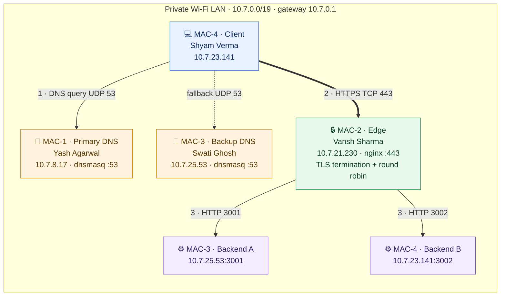
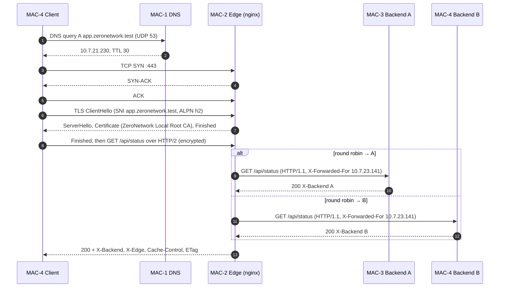
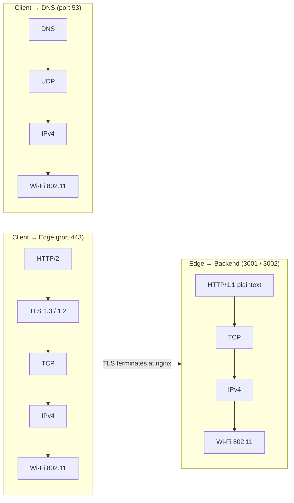
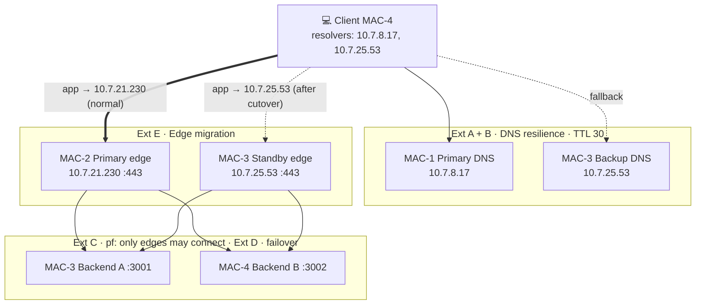

# ZeroNetwork — Private Network Service Platform

## Computer Networks Course Project — Phase 1 (Build & Observe) and Phase 2 (Harden & Recover)

> **Core principle:** *"The application stays simple; the network is the project."*

---

# 1. Project Purpose & Overview

ZeroNetwork is a private service platform on four macOS workstations on one local network, with no cloud. It follows one client request through every layer:

1. A client opens `https://app.zeronetwork.test`.
2. MAC-1 resolves the name with `dnsmasq` (TTL 30 s).
3. The client opens a TCP connection and a TLS session to the edge on MAC-2, port 443.
4. nginx terminates TLS and round-robins across Backend A and Backend B.
5. The backend answers with `X-Backend`, `Cache-Control` and `ETag` headers.
6. Every layer is observed with `dig`, `nc`, `openssl`, `curl -v` and Wireshark.

The project uses the reserved `.test` namespace, so it can never clash with a real domain.

---

# 2. Team Organization & Machine Roles

| Machine | Team Member | Primary Role | Main Service | Port |
|---|---|---|---|---:|
| **MAC-1** | **Yash Agarwal** | Private DNS (primary) + client | `dnsmasq` | `53` |
| **MAC-2** | **Vansh Sharma** | Edge: TLS termination, reverse proxy, round-robin load balancer | `nginx` | `443` |
| **MAC-3** | **Swati Ghosh** | Backend A. Phase 2: backup DNS + standby edge | Python HTTP service | `3001` |
| **MAC-4** | **Shyam Verma** | Backend B + main test client + Wireshark capture | Python HTTP service | `3002` |

Team name: **ZeroNetwork**.

---

# 3. Final Network Inventory

| Machine | IP | Interface |
|---|---|---|
| MAC-1 | `10.7.8.17` | `en0` (Wi-Fi) |
| MAC-2 | `10.7.21.230` | `en0` |
| MAC-3 | `10.7.25.53` | `en0` |
| MAC-4 | `10.7.23.141` | `en0` |

Subnet `10.7.0.0/19` (mask `255.255.224.0`), gateway `10.7.0.1`.

Private records (TTL 30 s):

```text
app.zeronetwork.test  ->  10.7.21.230
api.zeronetwork.test  ->  10.7.21.230
```

---

# 4. Final Architecture

> Full diagram set (including Phase 2 failover, isolation, cutover and troubleshooting): [`docs/diagrams/README.md`](docs/diagrams/README.md)

## 4.1 Network topology



Only the edge knows where the backends are. In Phase 2 a `pf` firewall makes the edge the only host allowed to reach ports 3001 and 3002.

## 4.2 End-to-end request flow



## 4.3 Protocol layers per leg



### One request, layer by layer

| # | Layer | From → to | Port | What happens |
|---|---|---|---:|---|
| 1 | DNS (UDP) | MAC-4 → MAC-1 | 53 | `app.zeronetwork.test` → `10.7.21.230`, TTL 30 |
| 2 | TCP | MAC-4 → MAC-2 | 443 | SYN, SYN-ACK, ACK |
| 3 | TLS | MAC-4 ↔ MAC-2 | 443 | ClientHello (SNI) → ServerHello → Certificate → Finished |
| 4 | HTTP/2, encrypted | MAC-4 → MAC-2 | 443 | `GET /api/status`, unreadable on the wire |
| 5 | HTTP/1.1, plaintext | MAC-2 → MAC-3 / MAC-4 | 3001 / 3002 | Round robin + `X-Forwarded-For` |
| 6 | Response | backend → edge → client | | `X-Backend`, `X-Edge`, `Cache-Control`, `ETag` |

---

# 5. Deliverables

Everything the project document asks for is indexed, with the marks mapping and demo sequence, in **[`DELIVERABLES.md`](DELIVERABLES.md)**.

---

# 6. Repository Structure

```text
backend-a/, backend-b/     REST backend (Python standard library only)
dns/                       dnsmasq config + A records
edge/                      nginx reverse proxy / load balancer / TLS config
tls/                       OpenSSL configs for the local CA and server certificate
tests/                     Verification scripts (DNS, HTTPS, load balancing, caching, failure, failover)
docs/                      Runbook, setup guide, topology, architecture, troubleshooting
docs/diagrams/             All architecture diagrams (Mermaid)
docs/demo-runbook.md       Final demonstration runbook (11 steps, who runs what)
phase2/                    Extensions A–F: configs, docs, evidence summary
evidence/                  Screenshots organised by task (see evidence/EVIDENCE_INDEX.md)
DELIVERABLES.md            Section 9 deliverables index, marks map, demo sequence
documentation/             Presentation Q&A, video script, project videos
```

---

# 7. Quick Start

```bash
# MAC-3
python3 backend-a/server.py A 3001
# MAC-4
python3 backend-b/server.py B 3002
# Any client Mac, after DNS and the CA are set up (see docs/setup-guide.md)
bash tests/run-all-tests.sh
```

Full ordered commands for every Mac: [`docs/runbook.md`](docs/runbook.md). **Final 11-step demo:** [`docs/demo-runbook.md`](docs/demo-runbook.md). Condensed guide: [`docs/setup-guide.md`](docs/setup-guide.md).

---

# 8. Phase 2 Extensions



| Ext | What | Result |
|---|---|---|
| A | Backup DNS on MAC-3 | Both resolvers answer; client lists both |
| B | TTL 30 s | A record change reaches clients within one TTL, or at once after a cache flush |
| C | Backend isolation with `pf` | Direct client access times out (exit 28); the edge still works; rollback restores access |
| D | Health-checked failover | Backend A stopped mid-stream: 0 failed requests, retried on B |
| E | DNS-based edge migration | Traffic moved from MAC-2 to the standby on MAC-3 in 3 s, with no failed request |
| F | Layered troubleshooting method | DNS → TCP → TLS → HTTP; the first failing layer is the fault |

Details: [`phase2/docs/phase2-final-report.md`](phase2/docs/phase2-final-report.md).

---

# 9. Evidence

Every screenshot's prompt shows `[ZeroNetwork | MAC-X | IP] time`. Index: [`evidence/EVIDENCE_INDEX.md`](evidence/EVIDENCE_INDEX.md).

| Task | Folder |
|---|---|
| A: LAN + connectivity | `evidence/task-a/` |
| B: Private DNS | `evidence/task-b/` |
| C: Backends | `evidence/task-c/` |
| D: Load balancing | `evidence/task-d/` |
| E: HTTPS / TLS | `evidence/task-e/` |
| F: HTTP caching (304) | `evidence/task-f/` |
| G: Wireshark | `evidence/task-g/` |
| Failure scenarios | `evidence/failures/` |
| Phase 2 | `evidence/phase2/` |

---

# 10. Presentation & Video

- **Project Demonstration & Presentation Videos:** [Google Drive Link](https://drive.google.com/drive/search?q=CN)
- 15-slide final presentation; likely questions and answers per slide: [`documentation/presentation-qa.md`](documentation/presentation-qa.md)
- Narrated project video script: [`documentation/video-script.md`](documentation/video-script.md)

---

# 11. Security Note

Private keys (`*.key`) and certificates are not committed. Generate them with the commands in [`tls/README.md`](tls/README.md).
