# ZeroNetwork — Architecture Diagrams

All diagrams are Mermaid, so GitHub renders them directly.

| # | Diagram | Shows |
|---|---|---|
| 1 | [Network topology](#1-network-topology) | Four Macs, roles, IPs, ports |
| 2 | [Request flow](#2-end-to-end-request-flow) | DNS → TCP → TLS → HTTP → backend |
| 3 | [TLS handshake](#3-tls-handshake-task-e) | ClientHello → Finished, trust chain |
| 4 | [Load balancing](#4-round-robin-load-balancing-task-d) | Round robin across A and B |
| 5 | [HTTP caching](#5-http-caching-task-f) | Fresh hit, conditional 304, full 200 |
| 6 | [Phase 2 architecture](#6-phase-2-architecture) | Backup DNS, standby edge, firewall |
| 7 | [DNS failover + TTL](#7-backup-dns-and-ttl-ext-a--b) | Primary down, record change |
| 8 | [Service isolation](#8-service-isolation-ext-c) | pf rules on MAC-3 and MAC-4 |
| 9 | [Backend failover](#9-backend-failover-ext-d) | Backend A stopped, zero failures |
| 10 | [Edge cutover](#10-dns-based-edge-cutover-ext-e) | MAC-2 → MAC-3 via DNS |
| 11 | [Troubleshooting ladder](#11-troubleshooting-ladder-ext-f) | DNS → TCP → TLS → HTTP |

---

## 1. Network topology

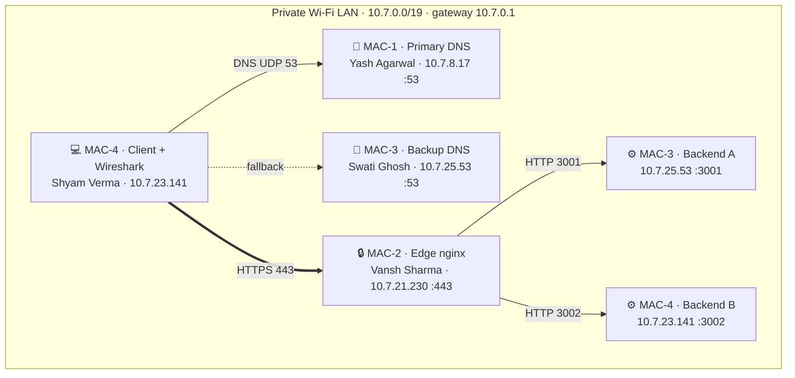

| Machine | Member | IP | Services |
|---|---|---|---|
| MAC-1 | Yash Agarwal | 10.7.8.17 | dnsmasq :53 |
| MAC-2 | Vansh Sharma | 10.7.21.230 | nginx :443 |
| MAC-3 | Swati Ghosh | 10.7.25.53 | backend A :3001, backup DNS :53, standby nginx :443 |
| MAC-4 | Shyam Verma | 10.7.23.141 | backend B :3002, client, Wireshark |

## 2. End-to-end request flow

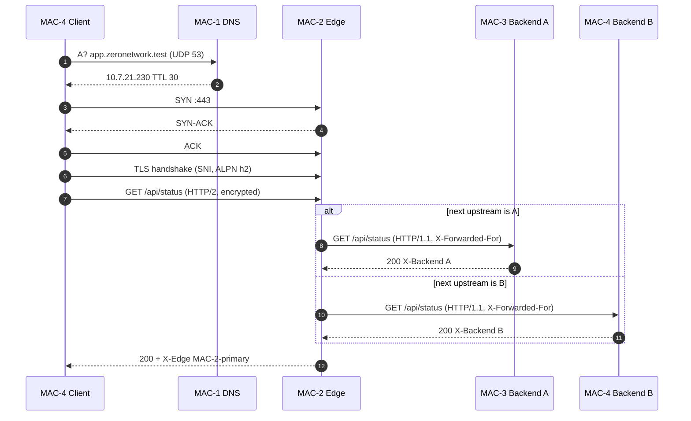

## 3. TLS handshake (Task E)

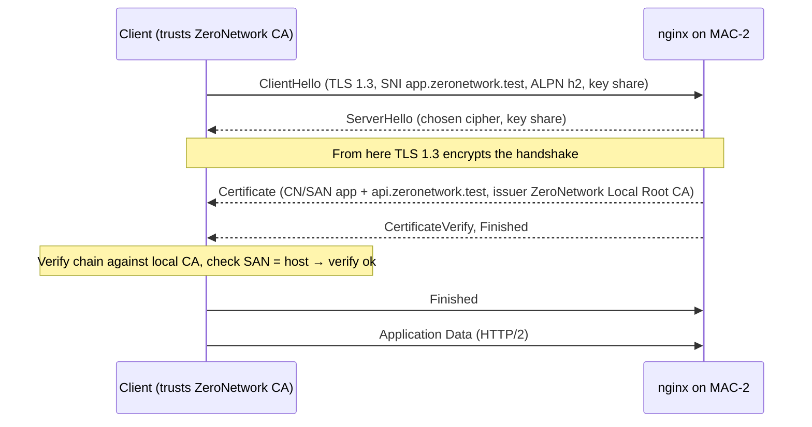

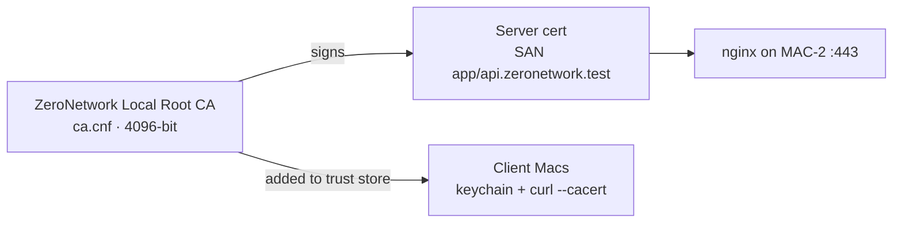

## 4. Round-robin load balancing (Task D)

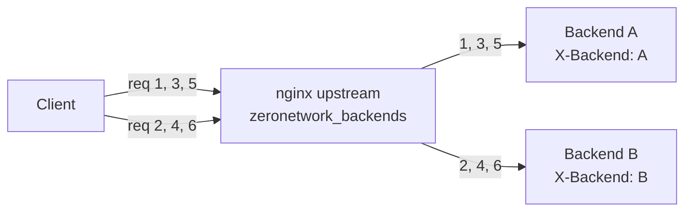

## 5. HTTP caching (Task F)

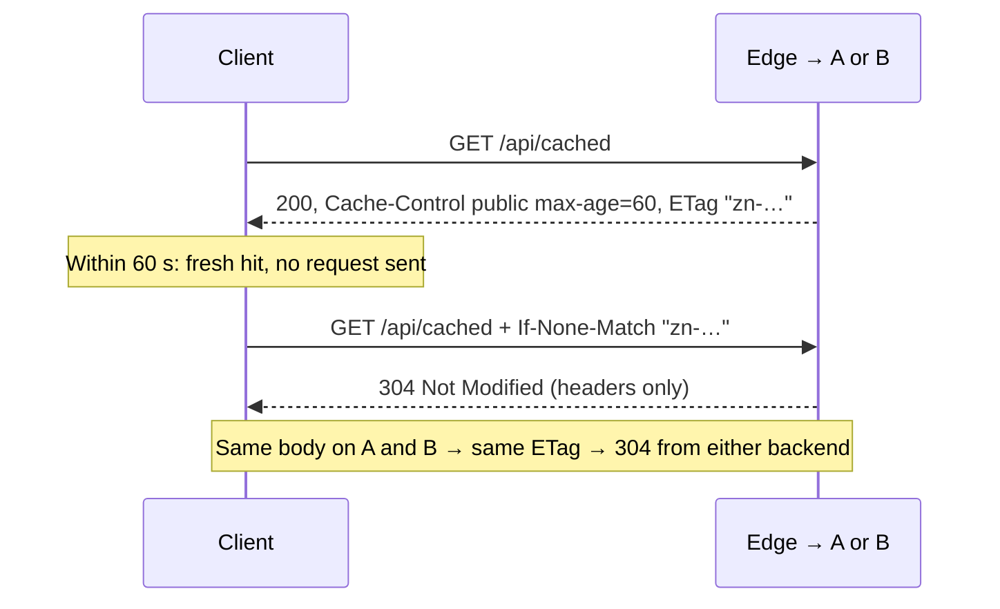

## 6. Phase 2 architecture

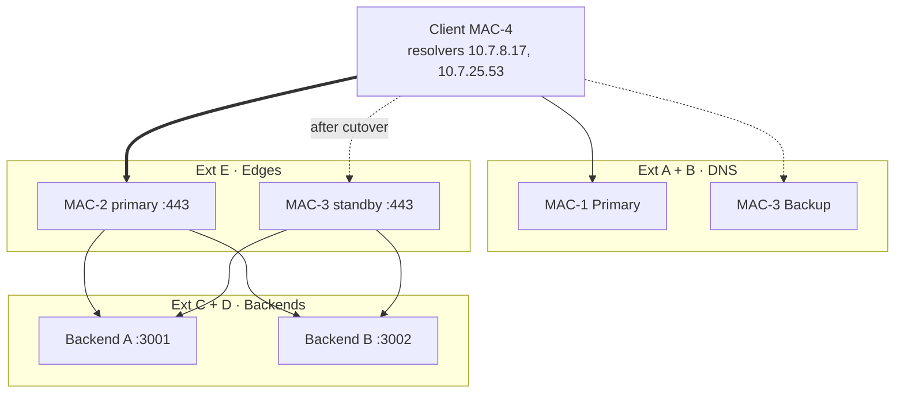

## 7. Backup DNS and TTL (Ext A + B)

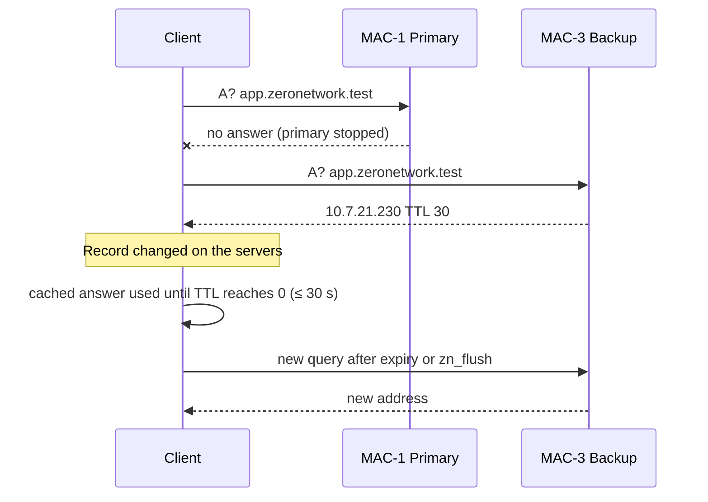

## 8. Service isolation (Ext C)

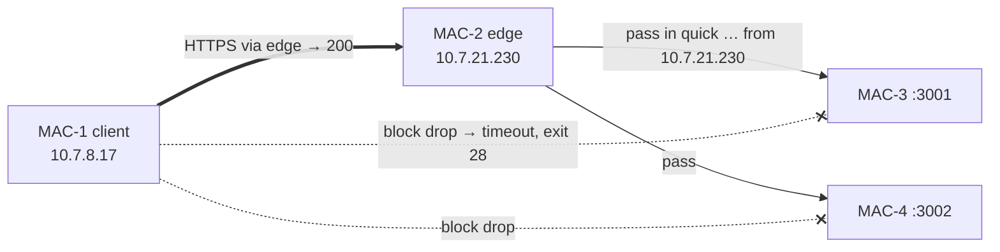

Rollback: `sudo pfctl -f /etc/pf.conf` (rules were added to a copy, never to the original).

## 9. Backend failover (Ext D)

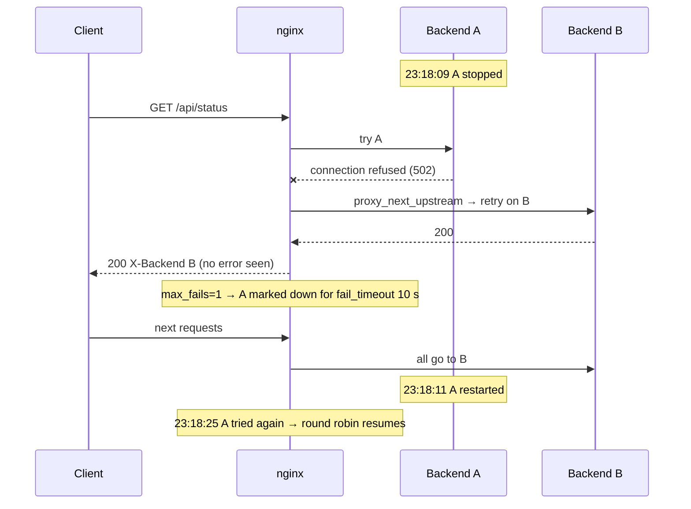

## 10. DNS-based edge cutover (Ext E)

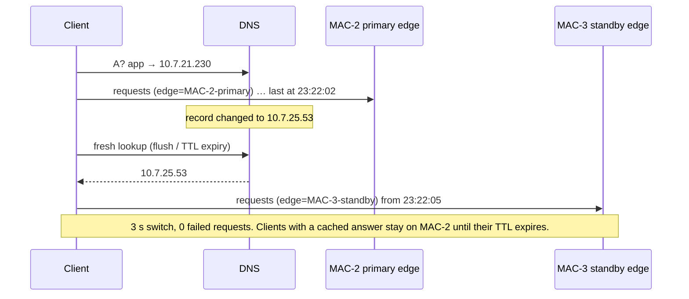

## 11. Troubleshooting ladder (Ext F)

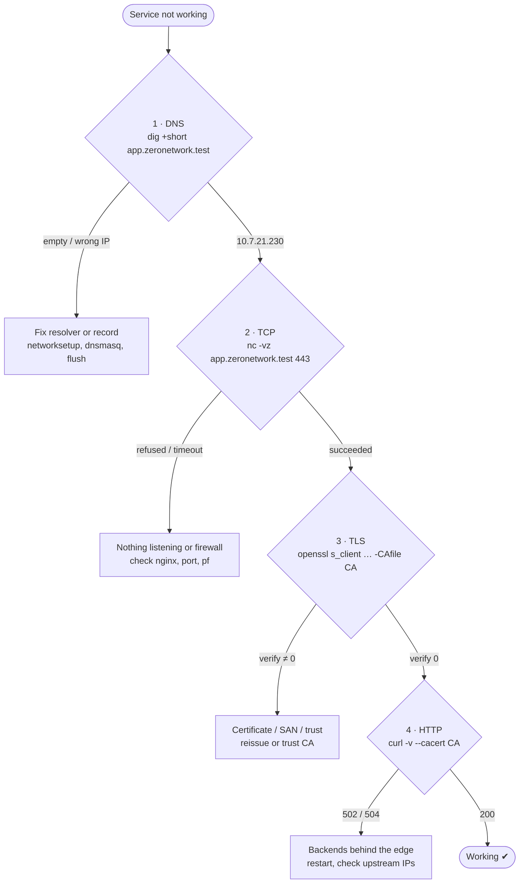
